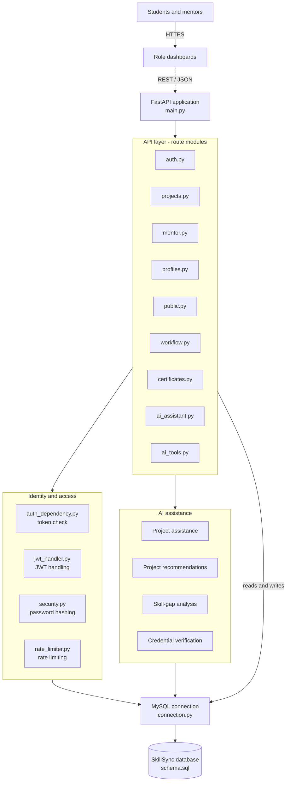

# SkillSync

**AI-assisted student project collaboration and management platform.**

SkillSync connects students and mentors in one place. Students form teams and manage projects, mentors guide and review the work, and built-in AI tools recommend projects, analyse skill gaps and help with project planning.

---

## Features

- **Role-based dashboards** for students and mentors
- **Secure authentication** with signup, login, JWT tokens, password hashing and rate limiting
- **Project and team management** with mentor assignment, mentoring and reviews
- **User profiles** and **public project views**
- **AI assistance**
  - Project assistant for planning and guidance
  - Project recommendations based on a student's skills
  - Skill-gap analysis against project requirements
  - Certificate / credential screening and verification
- **MySQL persistence** with a single shared connection layer

---

## System architecture

SkillSync follows a four-layer architecture: presentation, API, services and data.



### Layers

| Layer | Responsibility | Key files |
|---|---|---|
| Presentation | Role-specific dashboards for students and mentors | Web interface |
| API | Registers and serves all route modules | `main.py`, `routes/*` |
| Service | Authentication, security and AI logic | `auth_dependency.py`, `jwt_handler.py`, `security.py`, `rate_limiter.py` |
| Data | Database connection and schema | `connection.py`, `schema.sql` |

### Route modules

| Module | Purpose |
|---|---|
| `auth.py` | Signup and login |
| `projects.py` | Project and team management |
| `mentor.py` | Mentor management |
| `profiles.py` | User profiles |
| `public.py` | Public project views |
| `workflow.py` | Mentoring and reviews |
| `certificates.py` | Certificate screening (uses credential verification) |
| `ai_assistant.py` | Project assistant (delegates to project assistance) |
| `ai_tools.py` | Project recommendations and skill-gap analysis |

### Authentication flow

1. A user signs up or logs in through `auth.py`.
2. The password is hashed (`security.py`) and a JWT is issued (`jwt_handler.py`).
3. Login attempts are throttled by `rate_limiter.py`.
4. Protected routes verify the token through `auth_dependency.py`.

---

## Tech stack

- **Backend:** Python, FastAPI
- **Database:** MySQL
- **Auth:** JWT, hashed passwords, rate limiting
- **AI:** project assistance, recommendations, skill-gap analysis, credential screening
- **Frontend:** role-based web dashboards

---

## Getting started

> Adjust folder names and commands below to match your repository layout.

### Prerequisites

- Python 3.10+
- MySQL 8+
- `pip` and `venv`

### 1. Clone the repository

```bash
git clone https://github.com/abhaybagwari/skillsync-ai-assisted-student-project-collaboration-and-management-platform-.git
cd skillsync-ai-assisted-student-project-collaboration-and-management-platform-
```

### 2. Create a virtual environment and install dependencies

```bash
python -m venv venv
source venv/bin/activate        # Windows: venv\Scripts\activate
pip install -r requirements.txt
```

### 3. Set up the database

```bash
mysql -u <user> -p -e "CREATE DATABASE skillsync;"
mysql -u <user> -p skillsync < schema.sql
```

### 4. Configure environment variables

Create a `.env` file in the backend folder:

```env
DB_HOST=localhost
DB_PORT=3306
DB_USER=your_mysql_user
DB_PASSWORD=your_mysql_password
DB_NAME=skillsync

SECRET_KEY=change-this-to-a-long-random-string
ALGORITHM=HS256
ACCESS_TOKEN_EXPIRE_MINUTES=60

# Add any AI provider keys your AI tools need
# AI_API_KEY=your_key_here
```

### 5. Run the server

```bash
uvicorn main:app --reload
```

The API is now available at `http://127.0.0.1:8000`.
Interactive docs are at `http://127.0.0.1:8000/docs`.

---

## Project structure

```text
.
├── main.py                 # FastAPI app, registers all routers
├── routes/
│   ├── auth.py             # Signup and login
│   ├── projects.py         # Projects and teams
│   ├── mentor.py           # Mentor management
│   ├── profiles.py         # User profiles
│   ├── public.py           # Public project views
│   ├── workflow.py         # Mentoring and reviews
│   ├── certificates.py     # Certificate screening
│   ├── ai_assistant.py     # Project assistant
│   └── ai_tools.py         # Recommendations, skill-gap analysis
├── auth/
│   ├── auth_dependency.py  # Token authentication
│   ├── jwt_handler.py      # JWT creation and verification
│   ├── security.py         # Password hashing
│   └── rate_limiter.py     # Rate limiting
├── database/
│   ├── connection.py       # MySQL connection
│   └── schema.sql          # Database schema
└── README.md
```

---

## Roles

| Role | Can do |
|---|---|
| Student | Create and join projects, manage teams, get AI recommendations and skill-gap analysis, upload certificates |
| Mentor | Review projects, give feedback, manage mentees |
| Public visitor | Browse public project views |

---

## Contributing

1. Fork the repository
2. Create a feature branch: `git checkout -b feature/your-feature`
3. Commit your changes: `git commit -m "Add your feature"`
4. Push the branch: `git push origin feature/your-feature`
5. Open a pull request

---

## License

Add your license here (for example, MIT).
